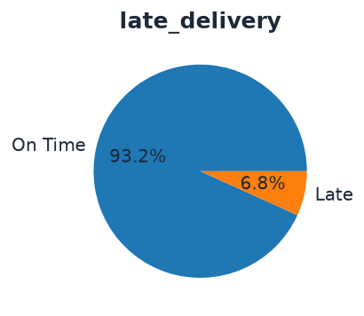
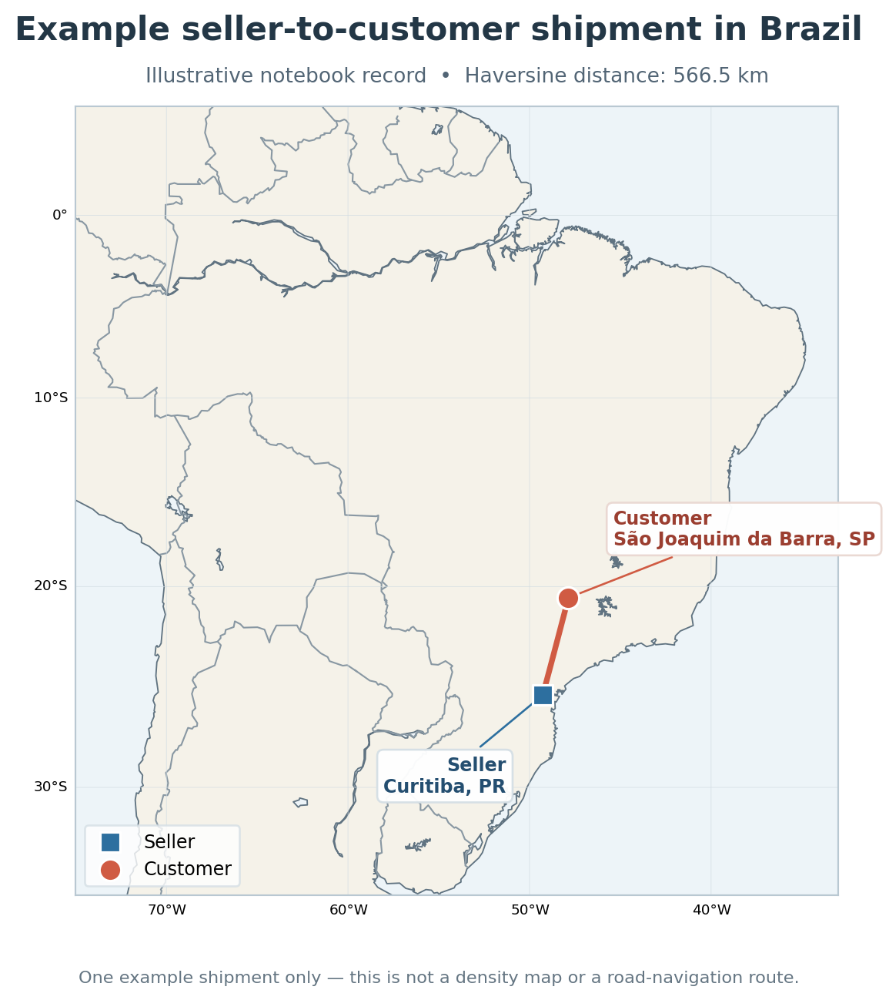

[Uploading README (11).md…]()
# Olist Late-Delivery Risk Scoring

**A time-aware machine-learning project that ranks Brazilian e-commerce orders by their risk of arriving after the promised date.**

[](https://www.python.org/)
[](https://pandas.pydata.org/)
[](https://scikit-learn.org/)
[](https://xgboost.readthedocs.io/)
[](https://python-visualization.github.io/folium/)

This project uses the public **Olist Brazilian E-Commerce dataset (2016–2018)** to investigate a practical operations question:

> At checkout, which orders should an operations team review first because they are more likely to arrive after the estimated delivery date?

The model is designed as a **risk-ranking tool**, not as a guarantee that a particular order will be late. The aim is to concentrate more late orders into a small review queue so that teams can prioritise seller follow-ups, shipment monitoring, or customer communication.

---

## Project at a glance

| | Result |
|---|---:|
| Overall late-delivery rate | **~6.8%** |
| August 2018 orders scored | 6,323 |
| Late rate in the highest-risk 10% | **17.3%** |
| Share of August late orders captured in the highest-risk 10% | **28%** |
| Best-performing model on the final test set | **Logistic Regression** |

**Main takeaway:** the model is more useful for prioritising a limited review queue than for making an automatic late/on-time decision for every order.

## 1. Business problem and operational use case

An order is labelled late when its actual customer-delivery date is after the estimated delivery date shown to the customer. The late class is relatively rare, accounting for approximately 6.8% of orders in the overall dataset.

A conventional accuracy score can therefore be misleading: a classifier that predicts *on time* for every order would achieve approximately 93.2% accuracy while finding **none** of the late orders.

The project instead focuses on ranking orders by predicted late-delivery risk. An operations team can then review the highest-scoring orders first, according to its available capacity.

### August 2018: what does the ranking achieve?

In an August 2018 scoring example, the model ranked 6,323 orders from highest to lowest risk:

| August order group | Orders reviewed | Late orders found | Late rate within group |
|---|---:|---:|---:|
| All August orders | 6,323 | 390 | 6.2% |
| Highest-scoring 10% | 632 | 109 | **17.3%** |
| Highest-scoring 1% | 63 | 22 | **34.9%** |

The top 10% contains **109 of the 390 late orders**, capturing approximately **28% of all late orders**. By comparison, a random 10% sample would be expected to contain about 10% of the late orders (roughly 39 in this example). The highest-risk 1% captures 5.6% of all late orders, compared with an expected 1% under random selection.




This is the intended business value: **review fewer orders while finding a larger share of the orders that eventually arrive late**. It does not mean every flagged order will be late. Most orders flagged by a binary threshold may still arrive on time, so the score should be treated as a prioritisation signal rather than a customer-facing probability.

## 2. Geographic and logistics view

Customer and seller ZIP-code prefixes are linked to latitude/longitude coordinates. These coordinates support a straight-line distance feature between the seller and customer.

<p align="center">
  <a href="figures/example_shipping_route.html">
    
  </a>
</p>

<p align="center">
  <a href="figures/example_shipping_route.html"><strong>Open the interactive example route map</strong></a>
</p>

The map illustrates one shipment record from the notebook: a seller in Curitiba, Paraná (PR), and a customer in São Joaquim da Barra, São Paulo (SP). The distance is approximately **566.5 km** using the Haversine formula. It is a straight-line estimate, not a road-navigation route or a map of all orders.

For each item, the Haversine distance is calculated as:

\[
 a = \sin^2\left(\frac{\Delta\phi}{2}\right) + \cos\phi_1\cos\phi_2\sin^2\left(\frac{\Delta\lambda}{2}\right),
 \qquad d = 2R\arcsin(\sqrt{a}), \quad R=6{,}371\text{ km}
\]

For multi-seller orders, item-level distances are averaged to produce an order-level distance feature.

### Generate an interactive order-distribution map

The repository also includes [`scripts/build_distribution_map.py`](scripts/build_distribution_map.py). Run it after the notebook has created the order-level `df_full_v1` DataFrame:

```python
from scripts.build_distribution_map import build_distribution_map

order_map = build_distribution_map(df_full_v1)
order_map
```

The script saves `figures/order_distribution_map.html` and provides three switchable layers:

- **Customer order density** — where customer orders are concentrated.
- **Late-delivery density** — where late orders are concentrated (counts, not late rates).
- **Late-delivery rate by state** — state-level rates, with marker size reflecting order volume.

The distribution map is generated from the full order-level coordinates when the notebook data is available. The static route image above is the preview included with this README; the route should not be mistaken for a full-data density map.

## 3. Data and preparation

The raw dataset is split across orders, customers, order items, sellers, products, payments, and ZIP-code geolocation tables. These sources are joined and then aggregated back to **one row per order**, because late delivery is an order-level outcome.

### Target definition

An order is late when:

\[
\text{late\_delivery} = \mathbb{1}(\text{delivery date} > \text{estimated delivery date})
\]

The estimated delivery timestamp is stored at midnight, so the comparison is made at the **calendar-date level**, not by comparing the time of day.

### Main cleaning decisions

- Remove records without the delivery timestamps required to determine the target.
- Deduplicate geolocation to one coordinate record per ZIP-code prefix; keep the first record and drop the city label from the coordinate lookup.
- Use inner joins for customer and seller ZIP-code coordinates; orders without matching coordinates are excluded.
- Remove cancelled orders and `not_defined` payment types.
- Convert payment type into boleto, credit-card, debit-card, and voucher indicators.
- Remove one order with an invalid shipping-limit date after checking the extreme `shipping_window_days` value.
- Aggregate item-level values to the order level before modelling.

## 4. Exploratory analysis

The monthly late-delivery rate is not stable. It stays around 3% for much of 2017, rises sharply in late 2017 and early 2018, reaches approximately 18.9% in March 2018, and then falls to approximately 1.2% in June 2018. This temporal variation is one reason to evaluate the models chronologically rather than randomly splitting rows.


Three patterns stand out in the exploratory analysis:

1. **Distance is associated with late delivery.** Orders travelling more than 1,000 km have a 10.4% late rate, compared with 4.4% for orders travelling less than 50 km.
2. **The promised delivery window is associated with the outcome.** Orders with a 1–7 day promise have a 15.1% late rate; those with an 8–14 day promise have a 4.5% late rate. The promise is part of the target definition, so this is an association — not evidence that a longer promise causes better delivery performance.
3. **Cross-state orders have a higher observed late rate.** The late rate is 8.0% for cross-state orders versus 4.5% for same-state orders. The boleto difference is small (7.3% versus 6.6%) and is not treated as a strong operational driver on its own.

## 5. Feature engineering

Features are intended to represent information available when the order is placed. Variables that reveal the current order's future delivery outcome are not used as model inputs.

| Feature group | Examples | Purpose |
|---|---|---|
| Delivery windows | `shipping_window_days`, `promised_delivery_window_days` | Capture the seller handling window and the delivery promise |
| Logistics | `avg_distance_km`, `same_state` | Represent shipment distance and whether seller/customer are in the same state |
| Order and product | Total price, freight, weight, volume; `multi_item`, `multi_seller` | Describe order value, size, and fulfilment complexity |
| Calendar | Cyclical hour/day features; holiday, Carnival, Black Friday, and Christmas flags | Capture recurring timing patterns |
| Historical performance | Seller, category, customer-state, and seller-state → customer-state route history | Summarise delivery outcomes that were already known before the current order |
| Recent platform performance | `platform_7d_shrunk_late_rate` | Record the platform's shrunk late-delivery rate over the preceding **7 days** |
| Interaction features | Distance × promised window; seller late rate × shipping window | Capture relationships between logistics and historical risk |

### Leakage-safe historical rates

Historical performance is only useful if it was known when the order was placed. Each completed delivery becomes observable at `order_delivered_customer_date`. A backward as-of join is used to attach cumulative history, with exact matches disabled so a delivery recorded at the same timestamp is not treated as prior knowledge.

Raw rates are unstable when there are few historical orders. They are shrunk toward an 8% prior with strength \(K=20\):

\[
\hat p = \frac{n_{late} + 20\times 0.08}{n+20}
\]

With no history, the estimate is 8%. As more observations accumulate, the group's own historical record receives more weight. The same shrinkage approach is applied to seller, category, customer-state, route, and recent platform performance.

For the platform feature, the recent window is **7 days**. It uses deliveries with a delivery timestamp in the interval \((t-7\text{ days},\ t)\), where \(t\) is the current order's purchase timestamp. Only deliveries completed strictly before the current order are counted. The 8% prior is frozen from the training period rather than recalculated using future validation or test outcomes.

### Time and interaction features

Two time windows are known at checkout and are represented in days:

\[
\text{shipping window} = \text{shipping limit} - \text{purchase time}
\]

\[
\text{promised window} = \text{estimated delivery date} - \text{purchase time}
\]

Hour and day of week are encoded cyclically so that 23:00 is close to 00:00, and Sunday is close to Monday:

\[
\sin(2\pi h/24),\ \cos(2\pi h/24),\qquad
\sin(2\pi d/7),\ \cos(2\pi d/7)
\]

Public holiday, Carnival, Black Friday, and Christmas-period indicators are based on the purchase date. Right-skewed variables such as price, freight, weight, volume, distance, and interaction terms are transformed with \(\log(1+x)\).

## 6. Modelling and evaluation

### Chronological data split

The split is based on purchase time so that validation and test orders occur after the training period.

| Dataset | Purchase period | Orders | Late orders | Late rate |
|---|---|---:|---:|---:|
| Train | Before 2018-03-01 | 56,988 | 3,758 | 6.59% |
| Validation | 2018-03 to 2018-05 | 20,448 | 2,065 | 10.10% |
| Test | 2018-06 to 2018-08 | 18,525 | 665 | 3.59% |

The sharp change in late-delivery prevalence between validation and test is important when interpreting PR-AUC. The random-ranking PR-AUC baseline is approximately equal to the positive-class prevalence: about 10.1% on validation and 3.59% on test.

### Models

Three classifiers were compared using the same feature set:

- **Logistic Regression** — standardised numeric features and `class_weight='balanced'`.
- **Random Forest** — class weighting to give the minority late-delivery class more influence during fitting.
- **XGBoost** — `scale_pos_weight` calculated from the on-time and late order counts in the training data.

The `best_thr` value is selected using validation predictions and then carried forward for test-set classification. PR-AUC and ROC-AUC are calculated from predicted scores, so they evaluate ranking quality independently of a single classification threshold.

### Model comparison

| Model | Validation PR-AUC | Validation ROC-AUC | Best threshold | Test PR-AUC | Test ROC-AUC |
|---|---:|---:|---:|---:|---:|
| **Logistic Regression** | 0.1801 | **0.6938** | 0.6964 | **0.0717** | **0.7001** |
| Random Forest | **0.2150** | 0.6631 | 0.6717 | 0.0302 | 0.4263 |
| XGBoost | 0.1740 | 0.6542 | 0.6581 | 0.0463 | 0.5886 |


**Logistic Regression is retained as the strongest candidate for the final ranking.** Random Forest has the highest validation PR-AUC, but its test PR-AUC falls below the test prevalence baseline and its test ROC-AUC is 0.4263. XGBoost is also weaker on the test period. Logistic Regression has the strongest test PR-AUC and ROC-AUC among the three models in this comparison.

The Logistic Regression test PR-AUC of 0.0717 is approximately twice the test prevalence baseline of 0.0359. This is a useful lift over random ranking, but the absolute PR-AUC remains modest; the model should therefore be evaluated as a prioritisation tool, not a highly accurate order-level classifier.

### Why PR-AUC and ROC-AUC tell different stories

- **ROC-AUC** measures how well the model ranks late orders above on-time orders across thresholds. It is less directly affected by the positive-class prevalence.
- **PR-AUC / Average Precision** focuses on precision and recall for the late class. Its baseline changes with the late-delivery rate, making it particularly useful for an imbalanced target.
- **Threshold metrics** such as Precision, Recall, and F1 depend on the selected threshold. They are important for operational decisions, but they do not replace threshold-independent ranking metrics.

## 7. What I learned

- **Class imbalance changes how success should be measured.** At a late rate of about 6.8%, an always-on-time classifier can achieve about 93.2% accuracy while finding no late orders. PR-AUC, Recall, Precision, and top-risk capture are more informative than accuracy alone.
- **Time-aware evaluation matters.** A model should be tested on later orders, not on a random mixture of past and future records. The target rate changes substantially from month to month.
- **Historical features need strict timing rules.** Seller, category, route, state, and platform performance must only include deliveries completed before the current order was placed. Shrinkage prevents small-history groups from producing extreme, unreliable rates.
- **A ranking can be useful even when a binary threshold is weak.** The operational question is often which 5% or 10% of orders to review first, not whether every order can be classified perfectly.

## Limitations and next steps

- The dataset covers historical orders from 2016–2018; current logistics patterns may differ.
- Late-delivery prevalence changes materially over time, so performance should be monitored by month and by geography.
- A high-risk score is a prioritisation signal, not a calibrated probability or a guarantee of delay.
- The next evaluation step is rolling/expanding-window validation across multiple future periods, followed by a final untouched test period.
- A practical deployment decision should define review capacity and the relative cost of a missed late order versus an unnecessary intervention.

## Project structure

```text
.
├── README.md
├── figures/
│   ├── example_shipping_route.png
│   ├── example_shipping_route.html
│   ├── late_delivery_share.png
│   ├── monthly_late_rate.png
│   ├── top_risk_capture.png
│   └── model_pr_auc_comparison.png
└── scripts/
    └── build_distribution_map.py
```

## Data source

[Olist — Brazilian E-Commerce Public Dataset](https://www.kaggle.com/datasets/olistbr/brazilian-ecommerce). The anonymised dataset covers Brazilian e-commerce orders from 2016 to 2018.
