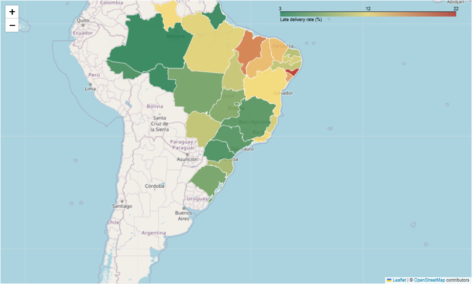
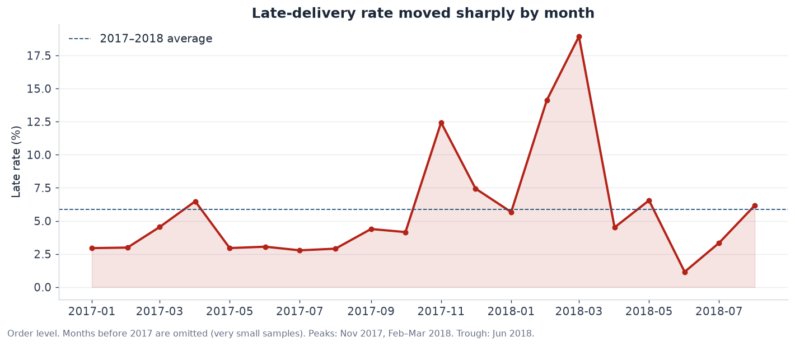
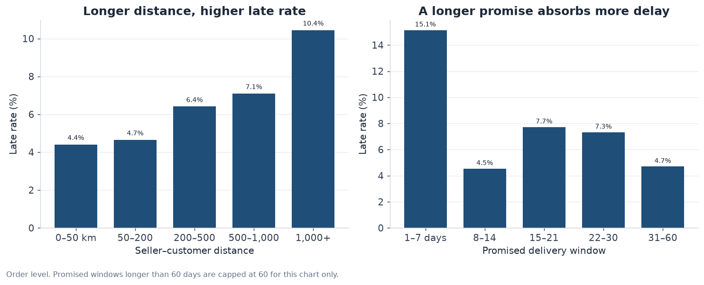
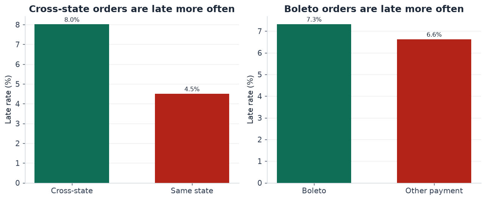
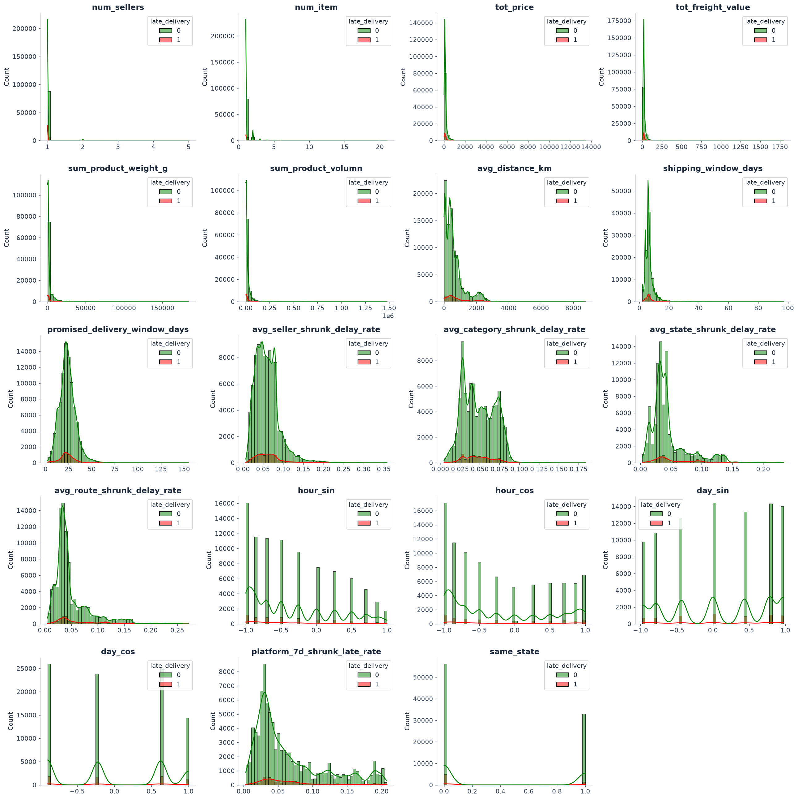

# Brazilian E-Commerce — Late Delivery Risk

**A time-aware classification and ranking project using Olist order data (Brazil, 2016–2018).**

At checkout, which orders are more likely to arrive after the estimated delivery date — and how can an operations team use that information to prioritise a limited number of at-risk orders?

This project builds an order-level late-delivery target, engineers features intended to be available at purchase time, compares three classifiers, and evaluates whether ranking orders by risk helps an operations team find more late deliveries within a fixed review capacity.

---

## Project snapshot

| Item | Result |
|---|---:|
| Model-ready order records | 95,961 |
| Late-delivery rate | 6.8% |
| On-time rate | 93.2% |
| Observation period | Oct 2016 – Aug 2018 |
| Prediction unit | One order |
| Champion model in the notebook | Logistic Regression |

The target is imbalanced: only a small share of delivered orders are late. Accuracy alone would therefore be misleading. The project focuses on PR-AUC, ROC-AUC, and — most importantly for the operational use case — the late-delivery rate and share of late orders captured within the highest-risk slice.

## Business question and intended use

The model is designed as a **risk-ranking tool**, not as an unquestionable yes/no prediction. It sorts orders by their estimated late-delivery risk so an operations team can review the highest-risk orders first.

Possible interventions include checking the seller, contacting the carrier, updating the delivery promise, or proactively notifying the customer. A high score is a reason to investigate, not proof that an order will be late.

### August 2018: same review capacity, more late orders found

The August 2018 application contains 6,323 orders, of which 390 were late.

| August 2018 slice | Orders reviewed | Late orders in slice | Late rate in slice |
|---|---:|---:|---:|
| All orders | 6,323 | 390 | 6.17% |
| Highest-risk 10% | 632 | 109 | 17.25% |
| Highest-risk 1% | 63 | 22 | 34.9% |

The highest-risk 10% contains **28% of all late orders** (109 of 390). A random 10% sample would be expected to contain about 10% of late orders — approximately 39 of the 390. In this August example, the risk ranking found about **2.8 times as many late orders** within the same review capacity.

The highest-risk 1% contains 22 of the 390 late orders, or 5.6%.


> **How to read the comparison:** “Top 10%” means the 10% of August orders with the highest model scores. It does not mean the model predicts that 10% of all orders will be late.

---

## Geographic distribution

The map below is the **actual Folium choropleth output saved in the uploaded notebook**. It shades Brazilian states by the observed late-delivery rate among orders delivered to customers in that state.



**[Open the interactive state map](https://github.com/Ed-Yeung/Olist-e-commerce-late-delivery-/blob/main/maps/late_delivery_rate_by_state.html)**

The interactive version supports zooming, panning, and state hover tooltips showing the state abbreviation and late-delivery rate. It is served from the included `docs/` folder using GitHub Pages.

The map is descriptive, not causal. State rates can be affected by differences in order volume, sellers, routes, and the time periods represented in the data.

---

## Exploratory analysis

### Late deliveries are a minority class


The model-ready data contains approximately 6.8% late orders and 93.2% on-time orders. A model that predicts every order as on time could achieve high accuracy while failing to identify any late orders.

### Late-delivery rate changes over time



The monthly pattern is not stable. The rate is close to 3% for much of 2017, rises sharply in November 2017 and February–March 2018, and falls to about 1.2% in June 2018. This variation is one reason the project uses chronological evaluation rather than a random train/test split.

### Distance and the promised delivery window



Two descriptive patterns stand out:

- Orders over 1,000 km have a 10.4% late rate, compared with 4.4% for orders within 50 km.
- Orders with a 1–7 day promised window have a 15.1% late rate. The 8–14 day group has a 4.5% late rate.

These are associations in the observed data, not causal effects. The promised window is also part of how the late outcome is defined: a longer promise gives the delivery more time to arrive before it is considered late.

### Same-state versus cross-state orders; payment type



Cross-state orders have an observed late rate of 8.0%, compared with 4.5% for same-state orders. The difference between boleto and other payment types is smaller: 7.3% versus 6.6%. Payment type is included as a feature, but this descriptive gap alone is not evidence that payment method causes delivery delays.

### Feature distributions



The notebook compares the distributions of numeric and engineered features for late and on-time orders. The historical platform feature shown here is the **7-day** shrunk late rate.

---

## Data and target construction

### Prediction grain

The raw files have different grains: orders, order items, customers, sellers, products, payments, reviews, and geolocation records. They are joined during preparation and then aggregated back to **one row per order**, because late delivery is an order-level outcome.

The model-ready table in the notebook contains 95,961 order records.

### Target definition

An order is labelled late when its actual customer-delivery calendar date is after its estimated delivery calendar date:

\[
\text{late\_delivery} =
\mathbb{1}\left(
\text{delivery date} > \text{estimated delivery date}
\right)
\]

The estimated delivery field is stored at midnight, so the comparison is based on calendar dates rather than delivery clock times. Orders without a usable delivery outcome and cancelled orders are excluded from the delivered-order target.

### Geographic distance

Customer and seller ZIP-prefix coordinates are used to calculate the great-circle distance with the Haversine formula (Earth radius: 6,371 km):

\[
a = \sin^2\left(\frac{\Delta \phi}{2}\right)
  + \cos(\phi_1)\cos(\phi_2)
    \sin^2\left(\frac{\Delta \lambda}{2}\right)
\]

\[
d = 2 \times 6371 \times
    \arcsin\left(\sqrt{a}\right)
\]

For an order containing items from multiple sellers, item-level distances are aggregated to the order.

---

## Feature engineering

The feature set is intended to represent information available when the customer places the order.

| Feature group | Examples | Why it is included |
|---|---|---|
| Order and basket | Order price, freight, item weight, volume, multi-item and multi-seller flags | Captures order size and handling complexity |
| Delivery promise | Seller shipping window; promised delivery window | Captures the time allowed for dispatch and delivery |
| Geography | Seller–customer distance; same-state indicator | Captures route distance and whether the order crosses a state boundary |
| Calendar | Public holiday, Carnival, Black Friday, Christmas period | Captures calendar effects |
| Cyclical purchase time | Sine/cosine of purchase hour and day of week | Preserves the cyclical relationship between 23:00 and 00:00, and between Sunday and Monday |
| Historical performance | Seller, category, customer-state, route, and platform late rates | Adds prior operational experience without using future delivery outcomes |

### Historical rates: time-aware and smoothed

A historical rate is only useful if it was known before the order was placed. The notebook uses backward as-of joins against each historical entity's delivery timestamp and disallows exact timestamp matches. This prevents an order from using its own delivery outcome or a later delivery as history.

Raw rates are unstable for entities with little history. The notebook shrinks the observed rate toward an 8% prior using \(K=20\):

\[
\widehat{p} =
\frac{n_{\text{late}} + 20 \times 0.08}
     {n + 20}
\]

The **platform recent-performance feature uses a 7-day window**, not 28 days:

- Feature: `platform_7d_shrunk_late_rate`
- Window: deliveries with delivery timestamps in \((t-7\text{ days},\,t)\)
- Only deliveries completed strictly before the order's purchase timestamp are included.
- The 8% prior is held fixed rather than recalculated using future test-period outcomes.

### Skewed variables and interactions

Right-skewed amount, distance, window, and interaction features are transformed with `log1p` before model fitting.

Two interactions are included:

- Average distance × promised delivery window
- Seller historical late rate × average distance

The model also converts `num_sellers` and `num_item` into `multi_seller` and `multi_item` flags because most orders have one seller and one item.

---

## Model development and evaluation

### Chronological split

The split follows purchase time. No future period is randomly mixed into the training data.

| Split | Purchase period | Orders | Late orders | Late rate |
|---|---|---:|---:|---:|
| Train | Before 2018-03-01 | 56,988 | 3,758 | 6.59% |
| Validation | 2018-03 to 2018-05 | 20,448 | 2,065 | 10.10% |
| Test | 2018-06 to 2018-08 | 18,525 | 665 | 3.59% |

The validation window includes the sharp March 2018 increase. The later test window has a substantially lower late-delivery prevalence. This is a deliberate temporal stress test: model performance must be interpreted alongside the changing positive-class rate.

### Models compared

Three classifiers are evaluated on the same feature set:

- **Logistic Regression** — standardised features and `class_weight="balanced"`.
- **Random Forest** — class-weight balancing; a small parameter grid is evaluated on validation data.
- **XGBoost** — `scale_pos_weight` is calculated from the training data; a small parameter grid is evaluated on validation data.

The classification threshold is selected on the validation set by maximising F1, then applied unchanged to the test set. PR-AUC and ROC-AUC are calculated from predicted scores, independent of the selected threshold.

### Model comparison

The table below uses the latest model-comparison results you shared after the notebook export.

| Model | Valid PR-AUC | Valid ROC-AUC | Best threshold | Test PR-AUC | Test ROC-AUC |
|---|---:|---:|---:|---:|---:|
| Logistic Regression | 0.1801 | 0.6938 | 0.6964 | 0.0717 | 0.7001 |
| Random Forest | 0.2150 | 0.6631 | 0.6717 | 0.0302 | 0.4263 |
| XGBoost | 0.1740 | 0.6542 | 0.6581 | 0.0463 | 0.5886 |

**Logistic Regression is the strongest of the three on the held-out test set in this comparison.** Random Forest has the highest validation PR-AUC, but its test ROC-AUC falls below 0.5, indicating worse-than-random ranking on this test period. XGBoost is also weaker on the test set.

The test late rate is 3.59%, so 0.0359 is the approximate random-ranking PR baseline for that test set. Logistic Regression's test PR-AUC (0.0717) is about twice that baseline. PR-AUC should always be interpreted relative to the prevalence of the positive class; it is not directly comparable across periods with very different late rates.

**Notebook synchronisation note:** the uploaded notebook's saved model-results output is an earlier run (Logistic test PR-AUC 0.0912 and ROC-AUC 0.7296). The table above uses the later model metrics you shared in chat. Re-run the model cells and save the notebook before publishing if you want the notebook's displayed results table to match this README.

### Walk-forward monthly evaluation

The notebook also retrains Logistic Regression on all orders before each month and scores the next month. The table below comes from the walk-forward chart cell, which uses one calendar month per evaluation window.

| Month | Orders | Late rate | PR-AUC | ROC-AUC | Late rate in top 10% |
|---|---:|---:|---:|---:|---:|
| 2018-03 | 6,969 | 18.94% | 0.3623 | 0.7107 | 46.7% |
| 2018-04 | 6,763 | 4.51% | 0.1373 | 0.7774 | 16.0% |
| 2018-05 | 6,716 | 6.55% | 0.1581 | 0.7388 | 19.9% |
| 2018-06 | 6,068 | 1.15% | 0.0571 | 0.7839 | 4.0% |
| 2018-07 | 6,134 | 3.34% | 0.0978 | 0.6817 | 12.0% |
| 2018-08 | 6,323 | 6.17% | 0.1506 | 0.7039 | 17.3% |

ROC-AUC is relatively more stable than PR-AUC across these months. PR-AUC changes with the underlying late-delivery rate, so a lower PR-AUC in a low-prevalence month does not automatically mean that ranking quality has collapsed.

### What the thresholded test result means

The notebook's Logistic Regression threshold is selected on validation data. On the June–August test set, the recorded classification report gives:

- Late-class precision: 5.7%
- Late-class recall: 84.2%
- Late-class F1-score: 0.106

This setting catches many late orders but also flags many orders that ultimately arrive on time. That is why the project presents the model primarily as a **ranking tool for prioritising a limited review queue**, not as an automatic late/not-late decision.

### Logistic Regression coefficients


The coefficients show the direction and relative magnitude of each standardised feature within this fitted model. They are conditional associations, not causal effects. Interaction terms are included, so an individual coefficient should not be interpreted in isolation.

---

## Key lessons

1. **Imbalanced classification needs the right metrics.** Accuracy can look strong while missing almost all late orders. PR-AUC, ROC-AUC, recall, and top-slice capture answer more relevant questions.
2. **Time-aware validation matters.** The late-delivery rate shifts sharply across months. A random split could hide how the model behaves when the operating environment changes.
3. **Historical features need strict point-in-time logic.** A late rate must only use outcomes already known at the time of purchase. The platform rolling rate uses the past 7 days.
4. **Ranking can be more useful than a hard label.** The August top-10% analysis shows how a risk-ranked queue can concentrate late orders, even when the default F1 threshold produces many false positives.

---

## Repository structure

```text
.
├── README.md
├── requirements.txt
├── .gitignore
├── data/
│   ├── README.md
│   └── raw/                       # Place the Olist CSV files here (not included)
├── notebooks/
│   ├── BrazilianE-Commerce_v5.1_cleaned.ipynb
│   └── source/
│       └── BrazilianE-Commerce_v5.1_cleaned_original.ipynb
├── figures/
│   ├── late_delivery_share.png
│   ├── monthly_late_delivery_rate.png
│   ├── late_delivery_rate_by_state.png
│   ├── distance_and_promised_window.png
│   ├── same_state_and_payment.png
│   ├── feature_distributions.png
│   ├── top_risk_late_rate.png
│   ├── late_orders_captured.png
│   └── logistic_coefficients.png
├── maps/
│   └── late_delivery_rate_by_state.html
└── docs/
    ├── index.html                 # GitHub Pages landing page
    └── maps/
        └── late_delivery_rate_by_state.html
```

