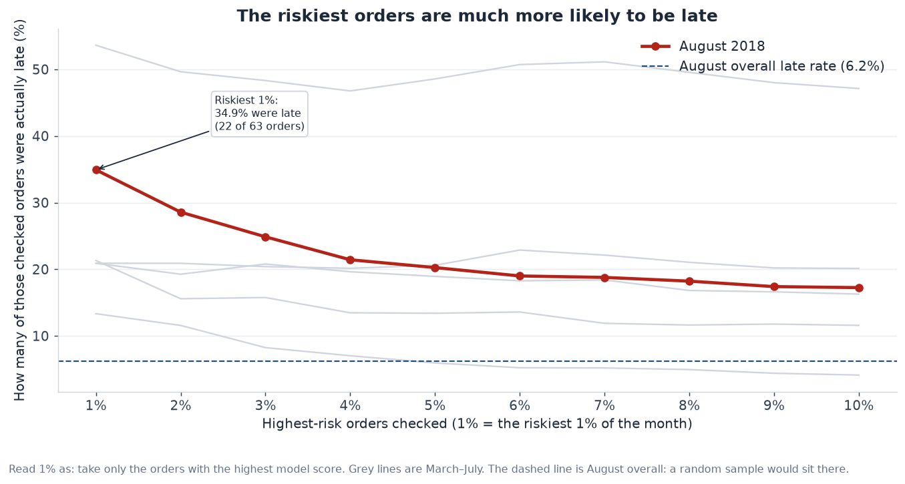
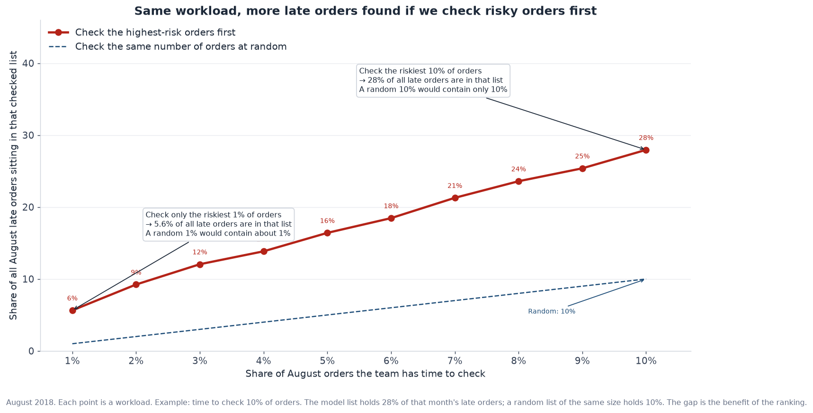
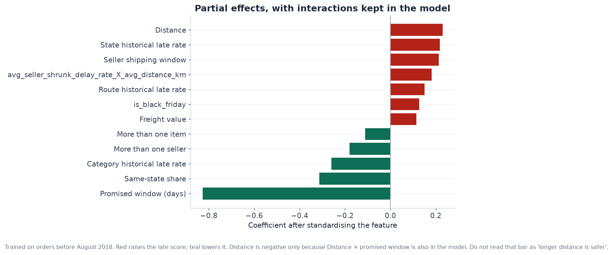

# Scoring which Olist orders are likely to arrive late

Public Olist orders, Brazil, 2016–2018. The question is simple: at the moment a customer checks out, which orders are more likely to arrive after the date already shown on the page.

An order is late when the delivery date is after the estimated delivery date. The estimated date is stored at midnight, so the comparison is on the calendar date, not the clock time. About 6.8% of delivered orders are late. The rate is not stable. It sits near 3% for much of 2017, jumps to about 19% in March 2018, and drops to about 1% in June 2018.

## What the model is actually for

The model is a ranking, not a yes/no flag. On August 2018 it was trained only on orders purchased before that month, then used to sort the 6,323 August orders.

| Slice | Orders | Late orders | Late rate |
|---|---:|---:|---:|
| All of August | 6,323 | 390 | 6.2% |
| Highest-scoring 10% | 632 | 109 | 17.3% |
| Highest-scoring 1% | 63 | 22 | 34.9% |

The top 10% holds 109 of the 390 late orders, which is 28%. Checking a random 10% would hold about 10%. The top 1% holds 5.6% of the late orders, against about 1% at random.

That is the business use. If someone only has time to review a small pile — extend the promise, warn the customer, or chase the seller — sorting by the score puts more of the late orders into that pile. It does not justify an automatic “this will be late” label. On the June–August test set, the threshold that maximised F1 still had precision of 5.7% on the late class (recall 84%, F1 0.11). Most of the orders it flags are on time.

The same walk-forward setup, one month at a time, kept a ROC-AUC between 0.69 and 0.78 from March to August. PR-AUC moved with the base rate: 0.36 in March, when 19% of orders were late, and 0.05 in June, when 1% were late. A stable ROC with a moving PR-AUC is what you should expect here.

| Month | Orders | Late rate | ROC-AUC | PR-AUC | Late rate in top 10% |
|---|---:|---:|---:|---:|---:|
| 2018-03 | 7,170 | 18.6% | 0.71 | 0.36 | 46.7% |
| 2018-04 | 7,015 | 4.5% | 0.78 | 0.14 | 16.0% |
| 2018-05 | 6,900 | 6.4% | 0.74 | 0.16 | 19.9% |
| 2018-06 | 6,224 | 1.1% | 0.78 | 0.05 | 4.0% |
| 2018-07 | 6,438 | 3.6% | 0.69 | 0.10 | 12.0% |
| 2018-08 | 6,323 | 6.2% | 0.70 | 0.15 | 17.3% |

## Data

The grain of the raw files is not the grain of the question. Orders, customers, items, sellers, products, payments and zip-code coordinates were joined, then collapsed back to one row per order, because “late” is an order outcome.

A few cleaning choices matter more than the rest:

- Orders with a missing timestamp were dropped. That keeps delivered orders and drops the ones that never got a delivery date, which is what the label needs.
- Geolocation is one row per zip prefix. The file has many duplicate prefixes; the first row was kept and the city name was dropped.
- Joins on zip code are inner joins. Orders with no matching coordinate are out. The loss was small.
- `not_defined` payments were removed. Payment type was turned into boleto, credit card, debit card and voucher flags.
- Cancelled orders were removed.
- One order with a broken shipping-limit date was removed after it showed up at the top of `shipping_window_days`.

Distance is the haversine distance between the customer zip and the seller zip, with Earth radius 6,371 km:

$$
a = \sin^2(\Delta\phi/2) + \cos\phi_1\cos\phi_2\sin^2(\Delta\lambda/2), \quad d = 2 \times 6371 \times \arcsin(\sqrt{a})
$$

A multi-seller order gets the mean of its item distances.

## What shows up before any model

Distance and the promise move the late rate in opposite directions. Orders over 1,000 km are late 10.4% of the time; orders under 50 km are late 4.4%. A promise of 1–7 days is late 15.1% of the time. A promise of 8–14 days is late 4.5%. The promise is not a cause of lateness. It is the denominator of the label. A longer promise is simply harder to miss.

Cross-state orders are late 8.0% of the time, same-state orders 4.5%. Boleto is only a small gap (7.3% against 6.6%) and I would not treat payment type as a driver.

## Features

Two clocks are known at checkout and were kept as days:

$$
\text{shipping window} = \text{shipping limit} - \text{purchase time}
$$

$$
\text{promised window} = \text{estimated delivery date} - \text{purchase time}
$$

Hour of day and day of week were stored as sin/cos so that 23:00 sits next to 00:00, and Sunday sits next to Monday:

$$
\sin(2\pi h/24),\ \cos(2\pi h/24), \quad \sin(2\pi d/7),\ \cos(2\pi d/7)
$$

Public holiday, Carnival, Black Friday and the Christmas period are flags on the purchase date.

The historical rates are the part that is easy to get wrong. A seller’s past late rate is useful, but it has to be the past that was already known when the order was placed. Each delivered order becomes visible at `order_delivered_customer_date`. For a new order I look up, with a backward as-of join and exact matches turned off, the cumulative counts for that seller, category, customer state, and seller-state → customer-state route. Nothing delivered on the purchase day or later is included.

A raw rate is a bad feature for a new seller. One late order out of one is 100%, and it is mostly noise. The rate is shrunk toward 8%, with strength $K = 20$:

$$
\hat p = \frac{n_{\text{late}} + 20 \times 0.08}{n + 20}
$$

With no history, $\hat p = 0.08$. After 20 orders the seller’s own results count as much as the prior. The same formula is used for category, customer state, route, and the platform’s own last 7 days. The 7-day rate uses deliveries whose delivery timestamp falls in $(t-7\text{ days},\ t)$, again strictly before purchase. The 8% prior was frozen from the training period rather than recomputed on the test months.

Item rows are then aggregated to the order: sum of price, freight, weight and volume; mean of distance and of the shrunk rates; max of the late flag. `num_sellers` and `num_item` are almost always 1, so they became two flags, `multi_seller` and `multi_item`.

Two products were added because the pieces interact: distance × promised window, and seller late rate × distance. Price, freight, weight, volume, distance and those products are right-skewed, so they go through $\log(1+x)$ before the model sees them.

## Models

The split is by purchase time, not by a random row cut.

- Train: before 1 March 2018
- Validation: March, April, May 2018, which includes the March spike
- Test: June 2018 onward

Three classifiers, same features. Logistic regression uses `class_weight='balanced'` and a standard scaler, because the class is about 1:14 and the coefficients are only comparable after scaling. Random forest uses the same class weight. XGBoost uses `scale_pos_weight` equal to the number of on-time training orders divided by the number of late ones. The decision threshold is chosen on the validation set by maximising F1, then frozen and applied to the test set.

| Model | Valid ROC-AUC | Valid PR-AUC | Test ROC-AUC | Test PR-AUC |
|---|---:|---:|---:|---:|
| Logistic regression | 0.68 | 0.17 | 0.73 | 0.09 |
| Random forest | 0.68 | 0.21 | 0.43 | 0.03 |
| XGBoost | 0.70 | 0.22 | 0.53 | 0.04 |

Logistic regression is the one I kept. The trees score a bit higher on the validation window and then fail once the late rate drops. A test ROC-AUC of 0.43 is worse than sorting at random. The logistic ranking still holds month by month in the table above.

The largest coefficients, on the standardised features, line up with the charts. A longer promised window lowers the score. Distance, the customer-state historical rate, the seller’s shipping window and the route historical rate raise it. The small negative bars on multi-item, multi-seller and category history are what is left after price, freight and the promise are already in the model. I do not read those as “more items are safer”.

The note printed under that chart is from an earlier specification, when distance and distance × promised window were both in the model and the distance bar flipped sign. In this fit the distance bar is positive, which matches the distance chart.

## What I learned

**Imbalance.** Accuracy is useless at a 6.8% late rate. `class_weight='balanced'` and `scale_pos_weight` stop the model from ignoring the rare class, but they also push the predicted scores upward. Those scores are for sorting. They are not probabilities I would show a customer.

**Cyclic time.** Putting hour in as 0–23 makes 23 and 0 look far apart. Sine and cosine fix that with two columns and no dummy for every hour.

**Shrinkage.** A historical rate with no history, or with one order, is not a rate. Pulling it toward a frozen prior (here 8%, with $K = 20$) is what makes a new seller comparable to an old one. The other half of “standardise” is the scaler in front of logistic regression: without it, a coefficient on distance in kilometres cannot be compared with a coefficient on a rate between 0 and 1.

**F1 against AUC.** F1 needs a cut-off. The cut-off that maximises F1 on this data flags a lot of on-time orders, so the F1 on the late class stays near 0.11 even when the ranking is real. ROC-AUC says whether the late orders tend to sit above the on-time ones. PR-AUC says the same thing while respecting how rare the late class is, which is why it collapsed in June and ROC-AUC did not. For this problem the number I would take to a stakeholder is the late rate inside the top 10%, not F1.
